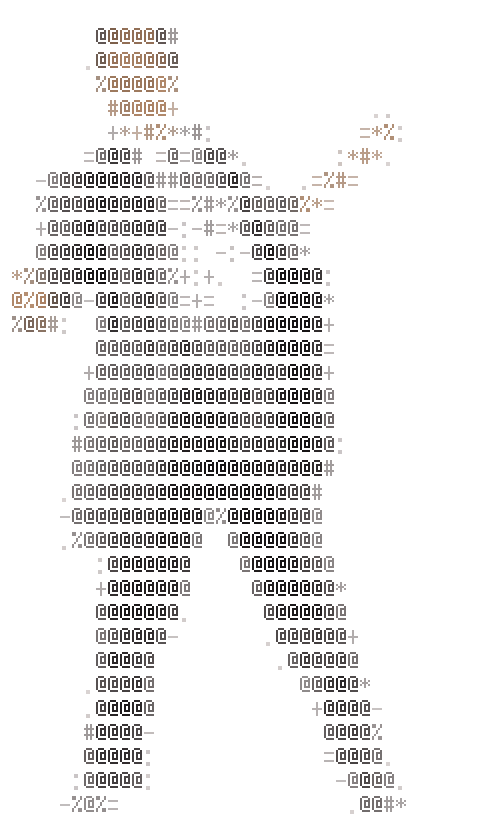

# gif2ascii2gif

Turn any GIF into a colored-ASCII animation that plays in your terminal. Then change it back to a GIF and impress your friends.

`gif2ascii.mjs` downloads a GIF, converts every frame to 24-bit-color ASCII, and writes a standalone player script. The player needs nothing but Node to run.

<p align="center">
  
</p>

## Requirements

- Node 18+
- `ffmpeg` 5.1 or later on your PATH (only for generating, not for playing; older versions lack `-fps_mode`); the test suite also uses `ffprobe`
- A truecolor terminal (`COLORTERM=truecolor`)

## Generate some ASCII from your favourite GIF

```bash
node gif2ascii.mjs <gif-url> [--width 40] [--bg-threshold 40] [--keep-bg] [-o out.mjs]
```

| Flag | Default | Meaning |
|---|---|---|
| `--width N` | `40` | Columns per frame. Height is derived from the GIF's aspect ratio, halved because terminal cells are about twice as tall as they are wide. |
| `--bg-threshold N` | `40` | How close (RGB distance, 0–179) a pixel must be to the background color to be blanked. Raise it if a halo of background remains; lower it if parts of the subject disappear. |
| `--keep-bg` | off | Keep the background and map brightness straight to the character ramp. |
| `-o path` | `players/<gifname>.mjs` next to the script | Where to write the player. |

Example:

```bash
node gif2ascii.mjs https://media.tenor.com/1iOUXZFLpBgAAAAM/dance-dancing.gif
# wrote .../players/dance-dancing.mjs: 17 frames, 40x33, 10.00 fps
```

Generated players live in `players/`, which is gitignored.

## Play it

```bash
node players/dance-dancing.mjs
```

It loops forever at the GIF's frame rate. Press Ctrl-C to quit; the player uses the alternate screen, so your terminal is restored exactly as it was.

## Export back to a GIF

`ascii2gif.mjs` renders a player's frames into a shareable GIF, keeping each character's color and the frame rate.

```bash
node ascii2gif.mjs players/dance-dancing.mjs [--scale 2] [--bg transparent|RRGGBB] [-o out.gif]
# wrote players/dance-dancing.gif: 17 frames, 504x840, 10.00 fps
```

| Flag | Default | Meaning |
|---|---|---|
| `--scale N` | `2` | Pixel scale (1–8). Each character is a 6x12 bitmap glyph before scaling. |
| `--bg transparent\|RRGGBB` | `transparent` | Background behind the characters. Transparent lets the GIF sit on any chat or page color; pass a hex color for a solid background. |
| `-o path` | the player path with `.gif` | Where to write the GIF. |

Glyphs are built in for the character ramp, so it needs no fonts or extra packages, only `ffmpeg`.

## How it works

1. The script downloads the GIF (or reads a local path) and walks its blocks with the same scanner the site uses (`site/lib/scan.mjs`) to get its dimensions and per-frame delays. The player uses their average (a frame with no delay counts as 0 ms, and delays under 20 ms count as 100 ms, as browsers do), clamped to 1–60 fps, the same rule the site uses.
2. `ffmpeg` reads the same bytes on stdin, scales every frame to the target size and emits raw RGB pixels, one frame per GIF frame.
3. The background color is detected as the most common color along the border of every frame. Pixels close to it become spaces; every other pixel gets a character from the ramp ` .:-=+*#%@` by how far it is from the background, colored with its own RGB value. With `--keep-bg`, the character is picked by brightness instead.
4. The frames are embedded as strings in the generated player, which redraws them in place on a timer.

## Notes

- Frame size is fixed at generation time. To change it, regenerate with a different `--width`.
- Make sure your terminal has at least as many rows as the frame height (printed on generation), or the top of the animation scrolls off.
- Background removal assumes a mostly solid background that touches the frame edges. Busy or gradient backgrounds won't blank cleanly; use `--keep-bg` for those.
- Player files are large (about 1 MB for 17 frames at 80 columns) because every character carries a color code.

## In the browser

`site/` is a static site that does both directions client-side: load a GIF by file, drag-and-drop, URL, or the demo button, adjust every option with live controls, watch the preview, and download the transparent GIF or the standalone player. Nothing is uploaded. GIFs over 300 frames, 1,264 blocks (frames plus extensions such as comments), 20 MB, 1024 pixels on a side, or 50 megapixels in all (frames × width × height), with a frame that extends past the GIF's screen, or more than 5 times taller than wide are refused so the tab stays responsive.

The site exports the GIF at exactly the source GIF's width and height, while the CLI's `ascii2gif.mjs` uses `--scale`, because a player file does not record the source size.

Run it locally with no build step:

```bash
npm run serve
# serving .../site at http://127.0.0.1:4173
```

The local server applies `site/_headers` (the same security headers the host serves). There is no Functions runtime locally, so `/api/event` returns 404, which the page ignores.

`functions/api/event.js` is a Cloudflare Pages Function that counts anonymous usage events (`convert`, `export_gif`, `export_player`, `blocked_too_large`) with only coarse, enumerated fields. Its only Cloudflare coupling is the Analytics Engine binding name `EVENTS`; all deploy configuration lives outside this repo.

## Layout

- `site/lib/` is the shared conversion core, imported by both CLI scripts and the site, so they cannot drift: `core.mjs` (ramp, frame sizing, background detection, character picking, ANSI frames), `glyphs.mjs` (6x12 bitmaps), `render.mjs` (ANSI frames back to RGBA), `player.mjs` (the player template), `scan.mjs` (a copy-free walk of the GIF's block structure, used for the site's limits and for both paths' frame delays), `decode.mjs` (browser GIF decoding and resampling), `export.mjs` (fitting the browser GIF export to the source size), `fetch.mjs` (fetching a GIF by URL with a time and size limit), and `events.mjs` (the usage event schema and privacy note).
- `site/vendor/` holds the vendored, unmodified [gifenc](https://github.com/mattdesl/gifenc) 1.0.3 and [gifuct-js](https://github.com/matt-way/gifuct-js) 2.1.2 (bundled with js-binary-schema-parser 2.0.3), each with its license and a `SOURCE.md` recording the source URL and SHA-256.
- `tests/` holds unit, integration, and browser tests, plus `serve.mjs`.

## Tests

Install the one dev dependency and the Chromium browser once:

```bash
npm install
npx playwright install chromium
```

Then:

```bash
npm test                  # unit + integration
npm run test:unit         # shared core, renderer, decoder, URL fetcher, event function, vendored file hashes
npm run test:integration  # CLI round trip and CLI-vs-site player parity (needs ffmpeg)
npm run test:e2e          # Playwright, Chromium only, one test at a time
```

Test GIFs are generated locally with ffmpeg's `lavfi` sources, so no test touches the network.
